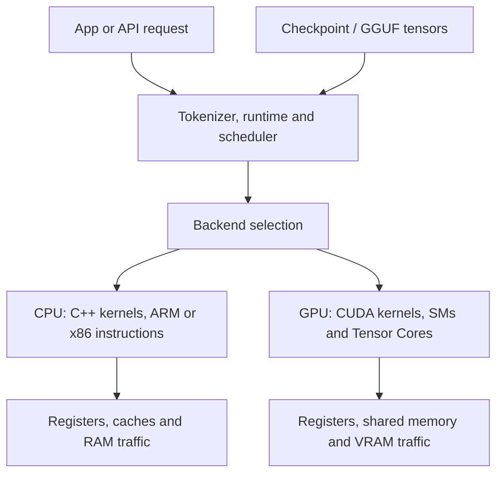

# Inference, CUDA and CIOT from first principles

Follow one request through the system. Each name below belongs to a particular part of that journey.

## 1. Start with numbers, memory and instructions

A computer stores bits. Eight bits make a byte. A number needs an agreed representation: an integer, a floating-point number, or a code that stands for a quantized value.

Memory holds those representations. A processor loads them, executes instructions, and stores results. An instruction can add, multiply, compare, move or rearrange numbers. Running an AI model requires both arithmetic and data movement.

Consider one weighted sum:

```text
input x = [2, 3, 4]
weights w = [1, 0, -1]
output = 1*2 + 0*3 + (-1)*4 = -2
```

This is a dot product. A matrix is many rows of weights. Multiplying it by a vector produces one weighted sum per row. A tensor is an array that can have more dimensions than a matrix.

One linear layer computes y = W*x, sometimes with an added bias. An LLM runs many such layers, with other operations between them. The whole model is much more than this one sum.

## 2. What a language model actually does

A tokenizer converts text into token IDs. A token may represent a word fragment, punctuation, a character or bytes. A token is not necessarily a word. A vocabulary is the set of token IDs the model recognizes.

An embedding table converts each input ID into a vector of numbers. Layers repeatedly transform those vectors. The current intermediate values are activations or hidden states. Parameters or weights are the learned numbers used to perform the transformations.

At the end, the output projection, often called the language-model head or lm_head, produces logits: one score for each possible next token. Softmax converts scores into probabilities. Greedy decoding chooses the highest-scoring token. Sampling chooses using a probability distribution; temperature changes how concentrated that distribution is. Top-k and top-p restrict the candidates considered.

The chosen token is appended to the context, and the model runs again. An autoregressive model builds its answer this way. One prediction depends on the text already present, including its earlier output.


An architecture describes how layers connect. A checkpoint contains trained parameters for that architecture. A runtime is the software that executes it. A faster runtime can preserve the model's answers while producing them sooner.

## 3. Training and inference

Training adjusts weights to reduce a loss: a number describing how wrong the predictions were. The forward pass calculates predictions. The backward pass calculates gradients, which indicate how changing parameters would change the loss. An optimizer uses them to update the weights. An epoch is a pass over a training dataset; a training step is one update.

Inference uses the learned weights to calculate predictions. Ordinary inference does not train on your current message. It still needs temporary activations and per-request state. Frameworks can disable gradient bookkeeping for inference. [PyTorch autograd documentation](https://docs.pytorch.org/docs/stable/notes/autograd)

Fine-tuning trains an existing model further. Distillation trains a student using information from a teacher. LoRA learns small additional parameter matrices instead of updating every original parameter. None of these describes CIOT's current kernel optimization.

## 4. The major operations inside the model

| Term | What it does |
|---|---|
| Attention | Combines information from earlier positions according to learned relevance scores. |
| Q, K, V | Query, key and value vectors used to calculate those scores and combine information. |
| Attention head | One set of these calculations; several heads can learn different relationships. |
| MHA | Multi-head attention with separate query, key and value heads. |
| GQA / MQA | Share key/value heads across query heads, reducing cached state. |
| FFN / MLP | The feed-forward network that transforms each position's features. |
| Nonlinearity | A transformation such as ReLU or SiLU that makes stacked layers more expressive. |
| RMSNorm / LayerNorm | Rescale intermediate features; these are part of model computation. |
| Residual connection | Adds a layer's input back to its transformed output. |
| RoPE | A way to encode position through rotations of attention features. |
| MoE | Mixture of experts: routing selects some expert networks for each token. |

These are model design choices. A kernel is an implementation of an operation within that design.

## 5. Prefill, decode and cached state

Prefill processes the prompt. Many input positions are available together, exposing parallel work and reuse of weights. Decode generates the continuation, often one token per request per step. Its next input depends on the previous prediction.

The KV cache stores attention keys and values already computed for earlier tokens, so the runtime can reuse them. Longer contexts generally need more cache space. Some architectures also carry recurrent state, an evolving summary of earlier computation. Bonsai's hybrid architecture in this project has both full-attention blocks and recurrent blocks; its rollback therefore involves more than trimming a KV cache. [Hugging Face cache documentation](https://huggingface.co/docs/transformers/v4.50.0/en/kv_cache)

GEMV means matrix-vector multiplication: one activation vector against many weight rows. GEMM means matrix-matrix multiplication: several activation vectors against the weights. One-request decode often resembles GEMV; prompt processing and batched decode can use GEMM. The amount of available reuse matters, not just which acronym appears.

## 6. Why memory can set the speed

Capacity is how many bytes fit. Bandwidth is how many bytes move per second. Latency is how long one access or task takes. Having enough RAM does not imply having enough bandwidth to run quickly.

Use this deliberately simplified example:

```text
weights read for one decode step = 6 GB
usable bandwidth = 100 GB/s
minimum weight-read time = 6 / 100 seconds = 60 ms
weight-only ceiling = roughly 16.7 steps/s
```

The actual model also needs arithmetic, state accesses and scheduling. Weight reuse, cache residency, sparsity and batching can change traffic. This is a rough bound for a stated workload, not a universal tokens/s formula.

Arithmetic intensity is operations performed per byte moved. Roofline analysis estimates an upper bound from both arithmetic throughput and bandwidth:

```text
attainable operations/s <= min(compute ceiling,
                              bandwidth * operations per byte)
```

A memory-bound operation waits mainly on data movement. A compute-bound operation is limited mainly by arithmetic throughput. A scheduling-bound workload spends substantial time launching, dispatching or coordinating work. Batching can increase weight reuse and shift the bottleneck. [NVIDIA matrix multiplication background](https://docs.nvidia.com/deeplearning/performance/dl-performance-matrix-multiplication/index.html)

Effective bandwidth must count the bytes a particular operation really reads and writes. Layout and access patterns can strongly affect it. [CUDA best practices](https://docs.nvidia.com/cuda/cuda-c-best-practices-guide/index.html)

The CIOT microkernel's recorded 107 GB/s is a kernel measurement. The complete model also performs other work. That is why approaching peak bandwidth inside one kernel does not mean the entire runtime has reached its overall ceiling.

## 7. Precision, quantization and ternary weights

| Representation | Basic meaning |
|---|---|
| FP32 | 32-bit floating point. |
| FP16 | 16-bit floating point, with a smaller numerical range than FP32. |
| BF16 | 16-bit floating point with exponent range similar to FP32 and fewer precision bits. |
| INT8 / INT4 | Eight-bit or four-bit integer codes, often interpreted using scales. |
| Accumulation precision | The representation used for partial sums; it can be wider than the inputs. |
| Quantization scale | Converts stored codes into an approximation of the original numerical values. |
| Zero point | An offset used by some quantization schemes. |
| Group size | How many values share quantization metadata such as a scale. |
| Dequantization | Interpreting compressed codes as numerical values for arithmetic. |

Quantization stores fewer bits per value. It can save memory and traffic, but representation errors can change predictions. PTQ, post-training quantization, compresses a model after training. QAT, quantization-aware training, exposes the model to quantization during learning. Calibration chooses parameters using representative inputs; it is not the same as retraining all the weights.

BitNet b1.58 uses ternary weights with values -1, 0 and +1. There are three states, so their ideal information content is log2(3), about 1.585 bits. Practical storage also includes scales, alignment and other non-ternary tensors. Five ternary codes can fit into one byte because 3^5 = 243. A two-bit layout spends more space but may be easier to decode. [BitNet paper](https://arxiv.org/abs/2402.17764)

Some ternary systems use rotations, including Hadamard transforms, to improve quantization. These require matching transformations elsewhere in the computation to preserve the intended model math. They are part of the format/model contract, not a trick the runtime can apply arbitrarily.

Ternary arithmetic permits additions and subtractions mathematically. Real hardware may run it fastest using its integer multiply-and-accumulate instructions. Smaller weight storage and the instruction used for arithmetic are separate choices.

## 8. CPU and ARM terms used in CIOT

The CPU runs the operating system and general program control. Its cores have registers for immediate arithmetic, caches for recently used data, and access to system RAM. A thread is a stream of program execution. Several CPU threads can handle different matrix rows.

An ISA, instruction-set architecture, specifies the instructions software can use. ARM64 and x86-64 are different ISAs. A compiler translates source into instructions for a target ISA. Code containing ARM intrinsics cannot execute those instructions natively on an x86 CPU.

SIMD means one instruction operates on several values in parallel. NEON is ARM's vector-instruction family. SDOT performs signed integer dot products. i8mm is ARM's integer matrix-multiplication extension; SMMLA is the instruction used by the T2P batch kernel. Intrinsics expose such operations through compiler-recognized functions.

A thread pool reuses workers. A barrier coordinates their progress. Core affinity controls where workers may run. Thread priority affects operating-system scheduling; it does not add arithmetic units or memory bandwidth. Persistent workers can reduce dispatch overhead but spinning and synchronization can consume resources.

## 9. What CUDA means

CUDA is NVIDIA's programming platform for running computation on its GPUs. A CUDA kernel is a function launched for GPU execution. Host code is the CPU side; device code is the GPU side.

| CUDA execution term | Meaning |
|---|---|
| Thread | One logical execution instance of kernel code. |
| Warp | A group of 32 threads scheduled together. |
| Block / CTA | A cooperating group of threads. |
| Grid | The blocks belonging to a kernel launch. |
| SM | Streaming multiprocessor: hardware that executes blocks and warps. |
| SIMT | Single instruction, multiple threads: the CUDA execution model. |
| Divergence | Threads follow different branches, reducing the work that executes together. |
| Stream | An ordered queue of device work. |
| CUDA event | A marker used for timing or dependencies. |

GPU registers hold per-thread values; shared memory is on-chip storage shared within a block; global memory is device memory accessible across the GPU. Accesses from nearby threads can be coalesced into efficient transactions. [CUDA programming guide](https://docs.nvidia.com/cuda/cuda-programming-guide/pdf/cuda-programming-guide.pdf)

VRAM is GPU memory. It must hold weights, per-request state and temporary buffers. GDDR and HBM are memory technologies, not model formats. CPU/GPU transfers cross an interconnect such as PCIe; repeatedly moving data across it can be costly. Offloading places some model work and data on another processor. Fitting the weight file in VRAM is not sufficient if the remaining buffers do not fit.

Ordinary CUDA arithmetic units execute scalar/vector work across threads. Tensor Cores specialize in matrix multiply-and-accumulate tiles; supported numerical formats depend on the GPU generation. Matrix shape, alignment and reuse affect efficiency. [NVIDIA matrix multiplication background](https://docs.nvidia.com/deeplearning/performance/dl-performance-matrix-multiplication/index.html)

Pinned host memory is prevented from being paged out and can help transfers. Unified memory provides a managed address space, with placement/migration costs; it does not turn small VRAM into unlimited fast memory. These are data-placement mechanisms. [CUDA best practices](https://docs.nvidia.com/cuda/cuda-c-best-practices-guide/index.html)

Occupancy is the fraction of possible resident warps that are active on an SM. Register pressure and shared-memory usage can limit it. Higher occupancy is not automatically higher performance. GPU utilization is a different metric, and neither proves maximum useful throughput. Nsight Compute inspects kernels and their bottlenecks. [Nsight Compute profiling guide](https://docs.nvidia.com/nsight-compute/ProfilingGuide/)

## 10. CUDA software layers and compilation

| Name | Where it fits |
|---|---|
| NVIDIA driver | Lets software control the GPU and execute device code. |
| CUDA Toolkit | Compiler, headers, libraries and development tools. |
| CUDA Runtime / Driver API | Interfaces for allocations, launches and other device operations. |
| nvcc | NVIDIA's compiler driver for CUDA C/C++. |
| PTX | An intermediate virtual instruction representation for device code. |
| SASS / cubin | Native GPU instruction code / its binary container. |
| JIT | Just-in-time compilation, for example translating a suitable intermediate representation for a device. |
| Compute capability | Identifies an NVIDIA GPU architecture's feature level. |
| cuBLAS | A library for linear algebra operations such as matrix multiplication. |
| cuDNN | A library of operations used in neural-network workloads. |
| NCCL | A library for collective communication among GPUs. |

CUDA source can be compiled into intermediate and native device code and packaged with the host program. Driver version, toolkit version and hardware capability are related compatibility concerns, but they are different quantities. [NVIDIA compiler documentation](https://docs.nvidia.com/cuda/cuda-compiler-driver-nvcc/), [NVIDIA explanation of PTX](https://developer.nvidia.com/blog/understanding-ptx-the-assembly-language-of-cuda-gpu-computing/)

Async means a CPU call can return before the GPU finishes its work. Timing only the CPU submission can mismeasure execution. A profiler or properly synchronized device timing is needed. [CUDA best practices](https://docs.nvidia.com/cuda/cuda-c-best-practices-guide/index.html)

## 11. Frameworks, runtimes and file formats

| Name | Its role in the stack |
|---|---|
| PyTorch | A framework for expressing and training models, also used for inference. |
| Hugging Face Transformers | Model implementations, tokenizers and associated inference/training APIs. |
| GGUF | A file container for model metadata and tensors; tensors inside can use different encodings. |
| GGML | A tensor library used by llama.cpp. |
| llama.cpp | An inference runtime with model loading, computation, generation and backends. |
| PrismML's fork | A variant of that runtime supporting its model/quantization conventions. |
| Backend | The implementation that executes tensor operations on a particular processor. |
| CIOT | Our kernels, integration work, experiments and evaluation tools around this runtime. |
| Triton | A language/compiler used to write tensor kernels, often for GPUs. |
| vLLM / SGLang / TensorRT-LLM | Names of LLM inference/serving systems; they are not model weight formats. |

A framework can call a runtime or library, which selects a backend, which launches a kernel, which executes machine instructions. The checkpoint supplies the numbers. These layers interact, but optimizing one layer does not automatically optimize the others.



## 12. Common optimization terms

| Term | The problem it addresses |
|---|---|
| Tiling | Divides a large calculation into pieces sized for the hardware and storage. |
| Repacking | Rearranges stored values into a layout useful for the kernel. |
| Fusion | Combines operations to reduce intermediate writes or dispatches. |
| Kernel launch overhead | Work required to submit and start a GPU operation. |
| CUDA Graph | Records device-work dependencies for replay, reducing some repeated submission work. |
| Neural-network graph | The model's operation/data relationships; a different meaning of graph. |
| FlashAttention | Computes attention in tiled form while reducing large intermediate memory traffic. |
| Sparsity | Some values or connections are absent/zero; speed benefits require an implementation that uses it efficiently. |
| Roofline | Relates workload arithmetic intensity to compute and bandwidth ceilings. |
| Amdahl's law | Overall speedup is limited by the work an optimization leaves untouched. |
| Profiling | Measuring where execution time and other resources are spent. |
| Bottleneck | The limiting resource or part of execution for the current workload. |

Faster does not mean changing arithmetic without checking it. Fusions, approximations and changes in floating-point summation can affect answers. Amdahl's law also explains why a very fast matmul need not create an equally large whole-model speedup.

## 13. Serving terms often used on Twitter

| Term | Plain meaning |
|---|---|
| Batch size | How many examples or requests are processed together. |
| Continuous batching | Admits and removes requests as they progress instead of waiting for one fixed batch to finish. |
| TTFT | Time to first token: queueing, prompt work and other startup costs before the first output. |
| ITL / TPOT | Inter-token latency / time per output token during generation. |
| Throughput | Useful work per time, often aggregate tokens/s or requests/s. |
| p50 / p95 / p99 | Median and tail percentiles of measurements, such as latency. |
| SLO | A service-level objective, such as a target latency for a stated fraction of requests. |
| Goodput | Useful completed work meeting the workload's requirements or latency objectives. |
| Prefix caching | Reuses computation for a matching prompt prefix. |
| Paged KV cache | Organizes cache storage into blocks to manage memory and reduce waste. |
| Prefill/decode disaggregation | Uses separate resources for the two phases and transfers needed state. |
| Speculative decoding | Guesses tokens cheaply and verifies them with the target model. |
| Acceptance rate | Fraction of drafted tokens accepted by the verification procedure. |
| Rollback | Restores state after rejected draft tokens. |
| MTP / draft model | Multi-token prediction or a smaller model used to propose drafts. |
| Tensor parallelism | Splits tensors/operations across devices. |
| Pipeline parallelism | Places groups of model layers on different devices. |
| Data parallelism | Replicates a model across workers for different data or requests. |
| All-reduce | A collective that combines distributed values and shares the result. |

Read any tokens/s claim with its workload: single user or many users, prompt length, generated length, batch size, model, precision, hardware and latency target. Aggregate serving throughput is different from the speed one person experiences.

Speculation can preserve the target model's output distribution with the right verification procedure. Greedy speculation can check exact next-token matches. Drafts still cost work, and rejected drafts need correct state handling. A high acceptance rate alone does not prove a speedup.

## 14. What CIOT currently changes

CIOT's T2P contribution rearranges the same PQ2_0 ternary codes into pairs of weight rows. The arrangement fits the ARM matrix instruction's operand shape. Separate integer accumulators handle slots carrying factors of 1, 4 or 16, and an activation-sum correction removes the stored +1 weight offset.

This saves repeated decoding/shuffling work. It also groups short verification batches so weights can be reused across their activation rows. It preserves the file format: the layout is internal to the runtime.

The recorded Snapdragon research integration shows about 3.8x faster prompt processing and 1.5x faster ordinary generation than its tested stock PQ2_0 baseline. Those are historical measurements on one machine. The clean contribution needs fresh ARM execution and model comparisons at the current upstream revision.

The separate speculative experiment reached about 14 tok/s on a code-edit prompt and matched its greedy output in the recorded checks. That result includes recurrent-state rollback work outside the clean repack patch.

Our RTX evaluation used the official CUDA runtime. It compared existing model choices on the same 8 GB GPU capacity. CIOT has not established a custom GPU-kernel speedup. A CUDA port would require a new layout/kernel design suitable for GPU execution and its own correctness and performance measurements.

## 15. Reading correctness and benchmark claims

Perplexity measures how surprised the model is by reference text. Lower can indicate better predictions for that text, but it is not a universal intelligence score. GSM8K grades math answers. HumanEval runs tests on generated code. Pass@1 refers to one generated candidate passing; it must be interpreted with the evaluation protocol.

Bit-exact means the compared bits agree. Agreement within a tolerance allows a measured numerical difference. Matching greedy tokens is a useful output check, but different logits can still choose the same token. Matching printed perplexity can hide differences beyond the displayed digits. A few prompts do not prove universal equivalence.

A microbenchmark measures a narrow operation; an end-to-end benchmark measures the full path. Warmup, repetitions, power state, temperature, CPU priority and background work affect results. Report the conditions and raw measurements.

For our contribution, the native repacked-buffer test checks bounded synthetic inputs against an independent scalar dot-product calculation. The paired token tool compares raw greedy IDs for three prompts. Both still need to run on ARM. The completed GPU accuracy set is small: first 60 math tasks and first 40 coding tasks, with capped generation and mixed timing conditions for Qwen 27B.

When someone says "we optimized inference," locate the change: model representation, data movement, a kernel, a runtime scheduler, batching, or the serving system. Then ask which measured bottleneck it removed and what evidence shows the answers remain correct.
